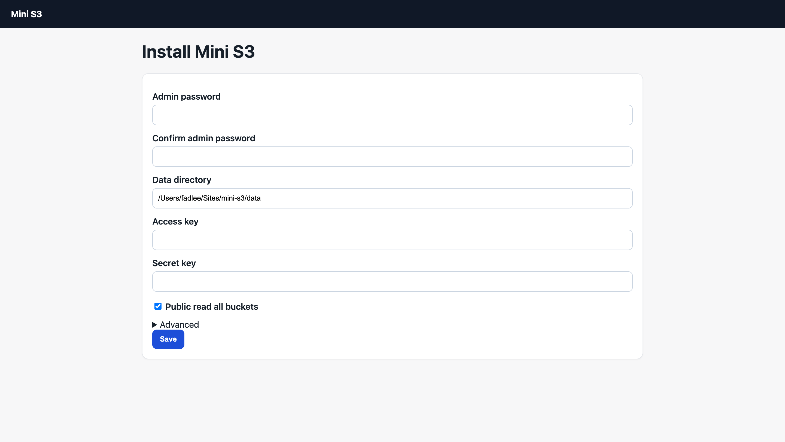
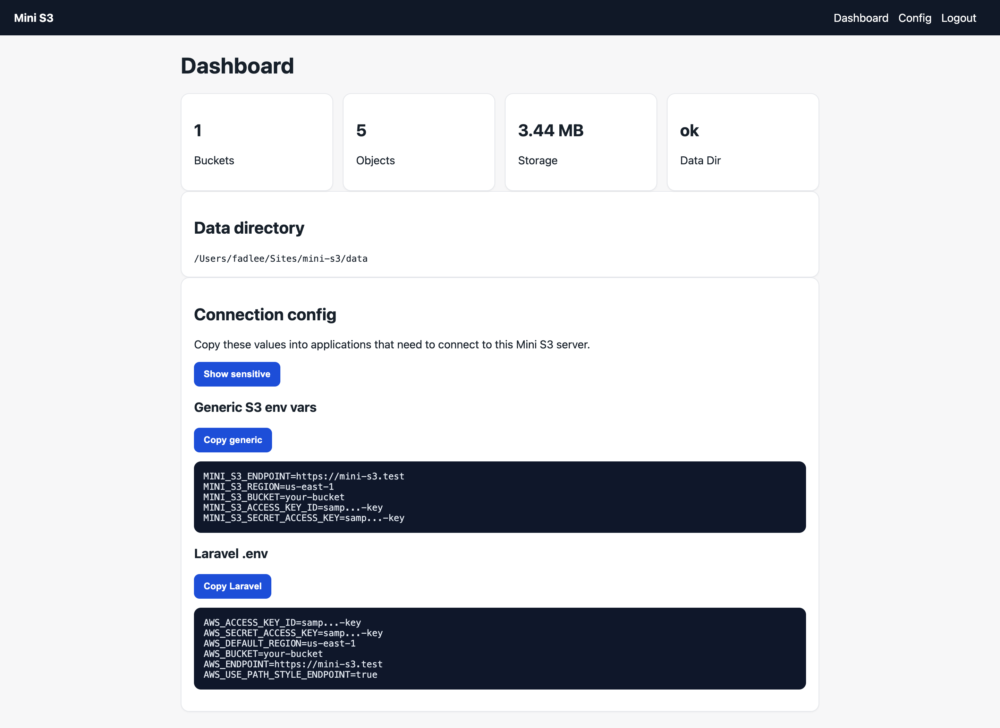

# Mini S3 Server

[](https://opensource.org/licenses/MIT)
[](https://github.com/fadlee/mini-s3/releases?q=go-v&expanded=true)
[](https://github.com/fadlee/mini-s3/releases)

Mini S3 Server is a lightweight S3-compatible object storage server that stores objects on the local filesystem. It needs no database. The project ships two implementations of the same server:

- **Go edition**: a single static binary and a Docker image (Alpine-based, no PHP inside).
- **PHP edition**: a single-file `index.php` release zip for PHP 8.x hosts behind Apache or Nginx.

## Which edition should I use?

| | Go edition | PHP edition |
|---|---|---|
| Best for | Docker, containers, or a single binary on a server | Shared hosting or an existing Apache/Nginx + PHP server |
| Get it from | Docker image `ghcr.io/fadlee/mini-s3-go`, or binaries on GitHub Releases (`go-vX.Y.Z` tags) | Release zip on GitHub Releases (`vX.Y.Z` tags) |
| Requirements | Docker, or the binary (no runtime dependencies) | PHP 8.0+, SimpleXML, ZipArchive, Apache or Nginx |
| Upgrades | Pull a new image tag (or replace the binary). The dashboard only shows an update notice. | In-app upgrade from the admin dashboard |
| Configuration | `config.yaml` plus the full set of `MINI_S3_*` environment variables | `config/config.php` plus a smaller set of `MINI_S3_*` environment variables |

## Key Features

- S3 object API compatibility (PUT, GET, DELETE, POST)
- Multipart upload support
- No database: objects are stored as files under a data directory
- AWS Signature V4 verification (header auth and presigned URLs)
- Web installer and admin UI at `/_` (dashboard, config, security, file explorer, update check)
- Two editions with the same S3 behavior (see [Which edition should I use?](#which-edition-should-i-use))

Objects are stored at `<data_dir>/<bucket>/<key>`. For example, bucket `music` and key `hello.mp3` are stored at `./data/music/hello.mp3`.

Bucket GET supports ListObjects V1 and V2 (`list-type=2`), including `prefix`,
`delimiter`, `max-keys` (0–1000), V1 `marker`, and V2 `start-after` and
`continuation-token`. Results are bytewise sorted; grouped common prefixes count
toward the page limit. V2 tokens are opaque, canonical base64url and bound to the
bucket, prefix, and delimiter. Tokens take precedence over `start-after`.

Use `encoding-type=url` for percent-encoded key fields and query values that
cannot be represented in XML. Invalid listing arguments return HTTP 400
`InvalidArgument`. A zero-sized page has no next cursor; request a positive
`max-keys` to continue. Pagination reflects current storage, not a snapshot.
`fetch-owner` is not implemented.

The Go edition also preserves the mixed object/common-prefix order and URL-encodes slashes as `%2F`. Its V2 continuation tokens use a byte-preserving format, including for non-UTF-8 keys in URL mode. See [Upgrading](#upgrading) for the token change in `go-v1.1.0`.

## Quick Start with Docker (Go edition)

This is the fastest way to run Mini S3. The image contains only the Go binary, runs as a non-root user, and listens on port 80 inside the container.

### Image tags

| Tag | Meaning |
|---|---|
| `ghcr.io/fadlee/mini-s3-go:X.Y.Z` | Release `go-vX.Y.Z` (the release tag without the `go-v` prefix) |
| `ghcr.io/fadlee/mini-s3-go:X.Y.Z-alpine` | Same build as the version tag (the base image is Alpine) |
| `ghcr.io/fadlee/mini-s3-go:latest` | Most recent `go-v*` release |

Images are published for `linux/amd64` and `linux/arm64`. For production, pin a version tag instead of `latest`. The current version is shown in the **Go edition** badge at the top of this README and on the [Releases](https://github.com/fadlee/mini-s3/releases) page.

> **Deprecated image name:** `ghcr.io/fadlee/mini-s3` is still published for a transition period. Switch to `ghcr.io/fadlee/mini-s3-go`.

### Run with `docker run`

```bash
docker run -d --name mini-s3 \
  --restart unless-stopped \
  -p 9000:80 \
  -e MINI_S3_PUBLIC_READ_ALL_BUCKETS=false \
  -v mini-s3-data:/data \
  -v mini-s3-config:/etc/mini-s3 \
  ghcr.io/fadlee/mini-s3-go:latest
```

To set credentials without the installer, add this line before the image name:

```bash
  -e MINI_S3_CREDENTIALS_JSON='{"my-access-key":"my-secret-key"}' \
```

Values passed with `-e` are visible in `docker inspect` and in your shell history. For real secrets, use `--env-file` with a file that only your user can read (`chmod 600`), or use a pre-provisioned `config.yaml` (see below).

To use host directories instead of named volumes, make them writable by the container user first (see [Volumes and ports](#volumes-and-ports)):

```bash
mkdir -p data config
sudo chown -R 65532:65532 data config

docker run -d --name mini-s3 \
  -p 9000:80 \
  -v "$PWD/data:/data" \
  -v "$PWD/config:/etc/mini-s3" \
  ghcr.io/fadlee/mini-s3-go:latest
```

### Run with Docker Compose

Save this as `compose.yaml`:

```yaml
services:
  mini-s3:
    image: ghcr.io/fadlee/mini-s3-go:${MINI_S3_VERSION:-latest}
    restart: unless-stopped
    ports:
      - "9000:80"
    environment:
      MINI_S3_PUBLIC_READ_ALL_BUCKETS: "false"
      # Optional: credentials without the installer
      # MINI_S3_CREDENTIALS_JSON: '{"my-access-key":"my-secret-key"}'
    volumes:
      - mini-s3-data:/data
      - mini-s3-config:/etc/mini-s3

volumes:
  mini-s3-data:
  mini-s3-config:
```

To pin a version, create a `.env` file next to `compose.yaml` with `MINI_S3_VERSION=X.Y.Z` (see the Go edition badge for the current version). Without it, Compose uses `latest`.

Start it with:

```bash
docker compose up -d
```

### First run

1. Start the container (see above).
2. Open `http://localhost:9000/_`. The installer appears because no `config.yaml` exists yet.
3. Complete the installer. It asks for the data directory, the first access key and secret key, and the admin username and password. It then writes `config.yaml` to `/etc/mini-s3` with a bcrypt password hash and a generated session secret.
4. Log in at `/_` to manage the config, security settings, and files.
5. Point S3 clients at `http://localhost:9000`. Use path-style addressing. The region can be any value, for example `us-east-1`.

> **Complete the installer before exposing the port.** While `config.yaml` does not exist, anyone who can reach `/_` can complete the installer and become the admin. Do one of these first:
> - finish the installer right after the first start,
> - bind the port to localhost only (`-p 127.0.0.1:9000:80`),
> - restrict the port with a firewall, or
> - pre-provision `config.yaml` (next section).

### Pre-provisioned `config.yaml`

If you write `config.yaml` before the first start, the installer does not appear. Put the file at `/etc/mini-s3/config.yaml` inside the container. A bind mount of a host directory is the simplest way to do this.

```yaml
data_dir: /data
max_request_size: 104857600
credentials:
  my-access-key: my-secret-key
public_read_all_buckets: false
clock_skew_seconds: 900
max_presign_expires: 604800
admin:
  username: admin
  password_hash: "<bcrypt hash>"
  session_secret: "<long random string>"
```

- If `admin.password_hash` is set, `admin.session_secret` is required. The server fails to start without it.
- Example bcrypt hash generator (any bcrypt tool works): `htpasswd -bnBC 10 "" 'your-password' | tr -d ':\n'`
- The file contains a password hash and a session secret. Keep it private and do not commit it.
- Other keys you can set: `allowed_access_keys`, `allow_legacy_access_key_only`, `auth_debug_log`, `allow_host_candidate_fallbacks`, `github_token`. See the [Configuration reference](#configuration-reference).

### Container environment variables

The most common variables for containers are below. The full list is in the [Configuration reference](#configuration-reference).

| Variable | Default | Purpose |
|---|---|---|
| `MINI_S3_DATA_DIR` | `/data` (set in the image) | Object storage directory |
| `MINI_S3_CREDENTIALS_JSON` | unset | JSON object of access keys and secrets, e.g. `{"key":"secret"}`. The S3 API works without the installer. |
| `MINI_S3_PUBLIC_READ_ALL_BUCKETS` | `true` | Set to `false` to require signed requests for all buckets |
| `MINI_S3_MAX_REQUEST_SIZE` | `104857600` (100 MiB) | Maximum request body size in bytes |
| `MINI_S3_GITHUB_TOKEN` | unset | GitHub token that raises the rate limit for update checks |

Environment variables override values in `config.yaml`. Empty values are ignored.

Until credentials exist (from `config.yaml`, `MINI_S3_CREDENTIALS_JSON`, or the legacy key settings), the S3 API returns `503 ServiceUnavailable` with the message "Mini S3 is not configured".

The admin UI at `/_` shows the installer whenever `config.yaml` does not exist, even if credentials come from environment variables. Admin environment variables (`MINI_S3_ADMIN_USERNAME`, `MINI_S3_ADMIN_PASSWORD_HASH`) only take effect once `config.yaml` exists.

### Volumes and ports

| Path in container | Contents | Notes |
|---|---|---|
| `/data` | Object storage | Set by `MINI_S3_DATA_DIR`. Owned by uid/gid 65532. |
| `/etc/mini-s3` | `config.yaml` | Written by the installer. The default `--config` path in the image. |

- The container listens on port `80`. Map it to any host port (`-p 9000:80`).
- The process runs as user `mini-s3` (uid/gid `65532`). Host bind mounts must be writable by that user, for example `sudo chown -R 65532:65532 ./data ./config`. Named volumes need no extra steps.

### Reverse proxy and TLS

The server speaks plain HTTP. Put a reverse proxy in front of it for TLS (Nginx, Caddy, Traefik, or similar). Two requirements:

1. **Pass the Host header unchanged.** AWS Signature V4 signs the Host header, so a proxy that rewrites it breaks signature checks. In Nginx, use `$http_host` (keeps the port) rather than `$host` (drops it). Caddy's `reverse_proxy` keeps the original Host by default.
2. **Allow large request bodies.** Set the proxy limit to at least `max_request_size` (100 MiB by default). In Nginx, use `client_max_body_size`.

```nginx
server {
    listen 443 ssl http2;
    server_name s3.example.com;

    ssl_certificate     /path/to/ssl/cert.pem;
    ssl_certificate_key /path/to/ssl/key.pem;

    client_max_body_size 100M;

    location / {
        proxy_pass http://127.0.0.1:9000;
        proxy_set_header Host $http_host;
    }
}
```

Use `allow_host_candidate_fallbacks` (`MINI_S3_ALLOW_HOST_CANDIDATE_FALLBACKS`) only if your proxy cannot pass Host correctly. When it is enabled, the verifier also accepts signatures made over these Host values: the value from `X-Forwarded-Host`, the Host without its port, and the Host with the default port added. This weakens strict Host matching. A client can also send `X-Forwarded-Host` unless your proxy overwrites it. Leave it off (the default) when Host is passed through.

A CDN can be placed in front of the proxy for caching and speed.

### Upgrading

- The admin dashboard checks GitHub for newer `go-v*` releases (result cached for 6 hours). The "Check for updates" button forces a fresh check. When a newer release exists, the dashboard shows the `docker pull` command for it.
- The Go edition has no in-app upgrade. Upgrade by changing the image tag and recreating the container.

With Compose:

```bash
# 1. Set MINI_S3_VERSION in .env to the new version (or keep latest)
# 2. Pull and recreate the container
docker compose pull && docker compose up -d
```

With `docker run`, pull the new tag, then stop, remove, and recreate the container with the same volume and port options.

Data and configuration live in the volumes, so they survive image upgrades.

> **Listing tokens from `go-v1.1.0`:** the Go edition rejects V2 continuation tokens issued by `go-v1.1.0`. After upgrading from that version, restart any listing that uses a continuation token without one.

## Go Edition Without Docker

Download a binary for your platform from the [GitHub Releases](https://github.com/fadlee/mini-s3/releases) page. Each release has binaries for `linux`, `darwin`, and `windows` on `amd64` and `arm64`, plus `checksums-sha256.txt`. Asset names look like this:

```text
mini-s3-go-vX.Y.Z-linux-amd64
mini-s3-go-vX.Y.Z-windows-amd64.exe
```

Verify the download and run it:

```bash
sha256sum -c checksums-sha256.txt --ignore-missing
chmod +x mini-s3-go-vX.Y.Z-linux-amd64
./mini-s3-go-vX.Y.Z-linux-amd64 --addr 127.0.0.1:9000 --config ./config.yaml
```

Command-line flags:

| Flag | Default | Meaning |
|---|---|---|
| `--addr` | `:80` | Listen address (`host:port`). Binding port 80 on Linux needs root or `CAP_NET_BIND_SERVICE`. |
| `--config` | `config.yaml` next to the executable | Path to the config file |
| `--version` | — | Print the version and exit |

Without a config file, the server starts and shows the installer at `/_`. The S3 API returns 503 until credentials exist. The installer proposes `data` next to the config file as the data directory. The `data_dir` default in code is `./data`, relative to the working directory. Set an absolute `data_dir` if you run the binary from a service manager or another directory.

Use a `config.yaml` like the one in [Pre-provisioned `config.yaml`](#pre-provisioned-configyaml).

## PHP Edition Installation

### Requirements

- PHP 8.0+
- PHP extensions: SimpleXML (`php8.2-xml` on Debian/Ubuntu) and ZipArchive (`php8.2-zip` on Debian/Ubuntu)
- Apache or Nginx (with mod_rewrite enabled for Apache)

### Installation steps

1. Deploy the project outside the public web root when possible.
2. Set the Apache or Nginx document root to `/path/to/mini-s3/public`. For release zips, use the extracted directory instead (see below).
3. Create a `data` directory, preferably outside the web root, and set `DATA_DIR` to that path.
4. Configure credentials with the web installer, environment variables, or a local `config/config.php`. Source installs may copy `config.example.php`. Release zips do not include it.
5. Configure URL rewriting (see the Apache and Nginx sections below).

### Release zip

Official release zips contain a generated `index.php` file plus a root `.htaccess` for Apache rewriting. Extract the archive, point the web server root at the extracted directory, then open `/_` to run the installer, or configure credentials with environment variables.

Release zips exclude source files, Composer metadata, example config, uploaded data, local config, tests, documentation internals, and repository automation files.

Source installs use `public/` as the document root, as shown below.

### Apache configuration

Example virtual host:

```apache
DocumentRoot /path/to/mini-s3/public

<Directory /path/to/mini-s3/public>
    AllowOverride All
    Require all granted
</Directory>
```

Rewrite rules in `public/.htaccess`:

```apache
<IfModule mod_rewrite.c>
    RewriteEngine On
    RewriteCond %{REQUEST_FILENAME} !-f
    RewriteCond %{REQUEST_FILENAME} !-d
    RewriteRule ^(.*)$ index.php [L,QSA]
</IfModule>
```

### Nginx configuration

Add this to your server block. For HTTPS, use the `listen 443 ssl http2;` form with certificate lines shown. For plain HTTP, use `listen 80;` and remove the `ssl_*` lines.

```nginx
server {
    listen 443 ssl http2;
    server_name your-domain.com;

    ssl_certificate /path/to/ssl/cert.pem;
    ssl_certificate_key /path/to/ssl/key.pem;

    root /path/to/mini-s3/public;
    index index.php;

    # Increase upload size limits
    client_max_body_size 100M;
    client_body_buffer_size 128k;

    location / {
        try_files $uri $uri/ /index.php?$query_string;
    }

    location ~ \.php$ {
        fastcgi_pass unix:/var/run/php/php8.0-fpm.sock;  # Adjust PHP version as needed
        fastcgi_index index.php;
        fastcgi_param SCRIPT_FILENAME $document_root$fastcgi_script_name;
        include fastcgi_params;

        # Required for AWS signature authentication
        fastcgi_param HTTP_AUTHORIZATION $http_authorization;
        fastcgi_pass_header Authorization;
    }
}
```

### Web installer and admin UI

Mini S3 reserves the `/_` route prefix for its built-in installer and admin UI.

If `config/config.php` does not exist, open `/_` in a browser to run the installer. The installer creates the local config, sets an admin username and password, configures the data directory, and creates the first access key and secret key.



After installation, open `/_` to log in. The admin dashboard shows bucket count, object count, total storage size, and data directory status. Use `/_/config` to edit runtime/S3 config values, and `/_/security` to update the admin username or password.



The admin UI writes `config/config.php`. Environment variables still override runtime config and are not editable in the UI.

### Configuring credentials

There are three ways to configure the PHP edition. `ConfigLoader` reads `config/config.php` first (or the legacy `config.php`), then applies environment overrides.

**Option 1: Environment variables.** The PHP edition reads only the variables listed in the [Configuration reference](#configuration-reference) (marked PHP there).

```bash
export MINI_S3_CREDENTIALS_JSON='{"prod-key":"prod-secret"}'
export MINI_S3_DATA_DIR='/var/lib/mini-s3/data'
```

**Option 2: Local `config/config.php`** (recommended for file-based config). Copy `config.example.php` to `config/config.php` and edit it. The file is ignored by git and should contain local deployment values only.

```php
<?php
return [
    'DATA_DIR' => __DIR__ . '/../data',
    'MAX_REQUEST_SIZE' => 100 * 1024 * 1024,
    'CREDENTIALS' => [
        'prod-key-1' => 'prod-secret-1',
    ],
    'ALLOW_LEGACY_ACCESS_KEY_ONLY' => false,
    'ALLOWED_ACCESS_KEYS' => [],
    'CLOCK_SKEW_SECONDS' => 900,
    'MAX_PRESIGN_EXPIRES' => 604800,
    'AUTH_DEBUG_LOG' => '', // Optional, e.g. /tmp/mini-s3-auth-debug.log
    'ALLOW_HOST_CANDIDATE_FALLBACKS' => false, // Keep false unless your proxy rewrites Host
    'PUBLIC_READ_ALL_BUCKETS' => false, // Set true to allow unsigned GET/HEAD for all buckets
    'ADMIN_USERNAME' => 'admin',
    'ADMIN_PASSWORD_HASH' => '',
    'GITHUB_TOKEN' => '', // Optional GitHub token for higher release-check rate limits
];
```

**Option 3: Legacy constant-based `config.php`** (deprecated, transition only). It is read only when `config/config.php` does not exist.

```php
<?php
define('DATA_DIR', __DIR__ . '/data');
define('ALLOWED_ACCESS_KEYS', ['minioadmin', 'another-key']);
define('MAX_REQUEST_SIZE', 500 * 1024 * 1024); // 500MB
define('ALLOW_LEGACY_ACCESS_KEY_ONLY', true);
```

> **Important**:
> - `CREDENTIALS` is the secure default mode.
> - `ALLOW_LEGACY_ACCESS_KEY_ONLY=true` disables full signature verification and is deprecated.
> - `CREDENTIALS` must not be empty unless legacy mode is explicitly enabled.
> - `ALLOW_HOST_CANDIDATE_FALLBACKS=false` enforces strict Host matching for SigV4 (recommended).

### Migrating `ALLOWED_ACCESS_KEYS` to `CREDENTIALS`

Old config:

```php
define('ALLOWED_ACCESS_KEYS', ['my-access-key']);
```

New config:

```php
return [
    'CREDENTIALS' => [
        'my-access-key' => 'my-secret-key',
    ],
];
```

## Configuration Reference

The table maps each setting to its key in each edition. Use `config.yaml` keys for the Go edition and `config/config.php` keys for the PHP edition. `—` means the setting does not exist in that edition.

| Setting | Go `config.yaml` key | PHP `config.php` key | Environment variable | Default | Meaning |
|---|---|---|---|---|---|
| Data directory | `data_dir` | `DATA_DIR` | `MINI_S3_DATA_DIR` (both) | Go: `./data`. PHP: `data/` in the project. | Where objects are stored. Use an absolute path outside the web root. |
| Max request size | `max_request_size` | `MAX_REQUEST_SIZE` | `MINI_S3_MAX_REQUEST_SIZE` (both) | `104857600` (100 MiB) | Maximum request body size in bytes (returns 413 when exceeded). |
| Credentials | `credentials` | `CREDENTIALS` | `MINI_S3_CREDENTIALS_JSON` (both) | empty | Access key to secret key map. Required unless legacy mode is enabled. |
| Public read | `public_read_all_buckets` | `PUBLIC_READ_ALL_BUCKETS` | `MINI_S3_PUBLIC_READ_ALL_BUCKETS` (both) | `true` (both) | Allow unsigned GET/HEAD (and bucket listing) on all buckets. Set `false` to require signatures. |
| Clock skew | `clock_skew_seconds` | `CLOCK_SKEW_SECONDS` | Go: `MINI_S3_CLOCK_SKEW_SECONDS` | `900` | Allowed difference between request time and server time. |
| Max presign expiry | `max_presign_expires` | `MAX_PRESIGN_EXPIRES` | Go: `MINI_S3_MAX_PRESIGN_EXPIRES` | `604800` (7 days) | Maximum lifetime of presigned URLs in seconds. |
| Auth debug log | `auth_debug_log` | `AUTH_DEBUG_LOG` | `MINI_S3_AUTH_DEBUG_LOG` (both) | empty (off) | File that receives signature debug output. See [Troubleshooting](#signature-mismatch-signaturedoesnotmatch). |
| Host candidate fallbacks | `allow_host_candidate_fallbacks` | `ALLOW_HOST_CANDIDATE_FALLBACKS` | `MINI_S3_ALLOW_HOST_CANDIDATE_FALLBACKS` (both) | `false` | Accept signatures over alternative Host values. See [Reverse proxy and TLS](#reverse-proxy-and-tls). |
| Legacy key-only mode | `allow_legacy_access_key_only` | `ALLOW_LEGACY_ACCESS_KEY_ONLY` | Go: `MINI_S3_ALLOW_LEGACY_ACCESS_KEY_ONLY` | `false` | Compatibility mode. Accepts requests with no SigV4 `Authorization` header that use a key from `allowed_access_keys`. Skips signature verification for those requests. The PHP edition marks this mode as deprecated. |
| Legacy access keys | `allowed_access_keys` | `ALLOWED_ACCESS_KEYS` | Go: `MINI_S3_ALLOWED_ACCESS_KEYS` (comma-separated) | empty | Keys for legacy mode. |
| Admin username | `admin.username` | `ADMIN_USERNAME` | Go: `MINI_S3_ADMIN_USERNAME` | `admin` | Username for `/_`. |
| Admin password hash | `admin.password_hash` | `ADMIN_PASSWORD_HASH` | Go: `MINI_S3_ADMIN_PASSWORD_HASH` | empty | bcrypt hash of the admin password. Set by the installer. |
| Session secret | `admin.session_secret` | — | — | generated by the installer | Signs admin sessions. Required when `admin.password_hash` is set. |
| GitHub token | `github_token` | `GITHUB_TOKEN` | `MINI_S3_GITHUB_TOKEN` (both) | empty | Optional. Raises the GitHub API rate limit for update checks. |

Notes:

- Environment variables override file values in both editions. Empty values are ignored.
- The Go edition reads a few settings that the PHP edition does not: `MINI_S3_CLOCK_SKEW_SECONDS`, `MINI_S3_MAX_PRESIGN_EXPIRES`, `MINI_S3_ALLOW_LEGACY_ACCESS_KEY_ONLY`, `MINI_S3_ALLOWED_ACCESS_KEYS`, `MINI_S3_ADMIN_USERNAME`, `MINI_S3_ADMIN_PASSWORD_HASH`.
- The PHP edition reads only `MINI_S3_DATA_DIR`, `MINI_S3_AUTH_DEBUG_LOG`, `MINI_S3_GITHUB_TOKEN`, `MINI_S3_MAX_REQUEST_SIZE`, `MINI_S3_PUBLIC_READ_ALL_BUCKETS`, `MINI_S3_ALLOW_HOST_CANDIDATE_FALLBACKS`, and `MINI_S3_CREDENTIALS_JSON`.
- The Go edition expects `MINI_S3_CREDENTIALS_JSON` as a JSON object such as `{"key":"secret"}`. The PHP edition expects the same format.

## Security

### Data directory protection

The data directory holds all uploaded files. Protect it from direct web access and script execution. Keeping it outside the web root is the strongest option.

#### Docker (Go edition)

- Objects live in the `/data` volume, not in the image.
- The container runs as uid/gid `65532`. Keep host bind mounts owned by that user and not writable by others (for example `chmod 750`).
- The container serves only the S3 API and `/_`. It does not serve the data directory as static files.

#### PHP edition: Apache

If `DATA_DIR` is missing its own `.htaccess`, the PHP edition creates one on first use. The generated file:

- denies all web access (`Require all denied`, or `Deny from all` on older Apache),
- turns off the PHP engine for the directory,
- removes PHP script handlers (`.php`, `.phtml`, `.phar`), and
- disables CGI execution and directory indexes.

This is defense in depth. Keeping `DATA_DIR` outside `public/` remains the recommended setup. Apache reads `.htaccess` files, so the generated rules apply only under Apache.

#### PHP edition: Nginx

Nginx ignores `.htaccess`. If `data/` is reachable from your server root, add this deny rule:

```nginx
location ~ ^/data/ {
    deny all;
    return 403;
}
```

### Best practices

1. **Use HTTPS**: Always deploy with TLS to encrypt data in transit. In Docker, terminate TLS at a reverse proxy.
2. **Finish setup before exposing the port**: Complete the installer, or pre-provision `config.yaml`, before the admin UI at `/_` is reachable from the internet.
3. **Require signed requests**: Set `PUBLIC_READ_ALL_BUCKETS` (`public_read_all_buckets`) to `false`. Its default is `true` in both editions.
4. **Strong credentials**: Use long, random values for access keys and secret keys. Generate a long random `session_secret` for the Go edition.
5. **Keep secrets out of source control**: Use `config/config.php` (PHP) or `config.yaml` (Go), and do not hardcode credentials. Pass secrets through an env file with restricted permissions instead of inline `-e` flags.
6. **File permissions**: Restrict the data directory, for example `chmod 750 data`, and give access only to the web server user (PHP) or uid `65532` (Docker).
7. **Keep software updated**: Update PHP and the web server (PHP edition), or change to a newer image tag (Go edition).
8. **Monitor access**: Review web server or container logs for suspicious activity.
9. **Firewall rules**: Restrict access to the S3 endpoint and `/_` where possible.

## Development and Testing

### PHP edition

```bash
php tests/lint.php
php tests/integration/run.php
php tests/release-archive.php
composer qa:lint
composer qa:test
composer qa:release-test
composer check
```

`composer` is optional and only provides development scripts. The PHP runtime does not require Composer.

### Go edition

```bash
cd go
go vet ./...
go build ./cmd/mini-s3
go test -race ./...
```

The Dockerfile does not compile Go. It copies pre-built binaries from `go/binaries/`, which the release workflow stages.

### Testing a running server

Run the included test script to check an installation. Edit `test-s5cmd.sh` to set your endpoint and credentials first:

```bash
./test-s5cmd.sh
```

The test script checks:
- File upload
- Bucket listing
- File download and content verification
- File deletion

The PHP integration suite (`php tests/integration/run.php`) checks:
- Valid/invalid SigV4 authorization header
- Strict Host verification for signed requests
- Valid/expired presigned URL
- Multipart upload flow
- Multipart upload session isolation
- Multipart temp files are hidden from object listing
- Invalid XML handling (`MalformedXML`)
- Request size limit enforcement (`413`)
- Range request behavior (`206` / `416`)

### Creating a release

Maintainers create releases by pushing a tag. The tag prefix selects the edition:

| Tag | Workflow | Output |
|---|---|---|
| `vX.Y.Z` (e.g. `v1.5.1`) | `.github/workflows/release.yml` | PHP release zip `mini-s3-vX.Y.Z.zip`, attached to the GitHub Release |
| `go-vX.Y.Z` (e.g. `go-v1.2.0`) | `.github/workflows/go-release.yml` | Go binaries for linux, darwin, and windows (amd64, arm64), `checksums-sha256.txt`, and Docker image tags `X.Y.Z`, `X.Y.Z-alpine`, and `latest` |

```bash
git tag v1.5.1        # PHP release zip
git push origin v1.5.1

git tag go-v1.2.0     # Go binaries and Docker image
git push origin go-v1.2.0
```

The Go release workflow also accepts a manual run (`workflow_dispatch`) with a version input such as `go-v1.2.0`.

To test PHP packaging locally:

```bash
php scripts/build-release.php v0.0.0-test
php tests/release-archive.php
```

## Usage Examples

The examples use placeholder keys (`minioadmin`) and the endpoint `https://your-domain.com`. Replace them with your own values. For the Docker quick start, use `http://localhost:9000` and path-style addressing.

### AWS CLI

Configure credentials:

```bash
aws configure
# AWS Access Key ID: minioadmin
# AWS Secret Access Key: must match the configured secret key
# Default region name: us-east-1
# Default output format: json
```

Basic operations:

```bash
# Upload a file
aws s3 cp file.txt s3://mybucket/file.txt --endpoint-url https://your-domain.com

# List bucket contents
aws s3 ls s3://mybucket/ --endpoint-url https://your-domain.com

# Download a file
aws s3 cp s3://mybucket/file.txt downloaded.txt --endpoint-url https://your-domain.com

# Delete a file
aws s3 rm s3://mybucket/file.txt --endpoint-url https://your-domain.com

# Sync directory
aws s3 sync ./local-folder s3://mybucket/folder/ --endpoint-url https://your-domain.com
```

### s5cmd (High-performance S3 tool)

```bash
# Set environment variables
export AWS_ACCESS_KEY_ID="minioadmin"
export AWS_SECRET_ACCESS_KEY="minioadmin"
export AWS_REGION="us-east-1"
export AWS_S3_FORCE_PATH_STYLE=1  # Required for path-style URLs

# Upload file
s5cmd --endpoint-url https://your-domain.com cp file.txt s3://mybucket/file.txt

# List bucket
s5cmd --endpoint-url https://your-domain.com ls s3://mybucket/

# Download file
s5cmd --endpoint-url https://your-domain.com cp s3://mybucket/file.txt ./downloaded.txt

# Delete file
s5cmd --endpoint-url https://your-domain.com rm s3://mybucket/file.txt

# Batch operations
s5cmd --endpoint-url https://your-domain.com cp '*.jpg' s3://mybucket/images/
```

### Python (Boto3)

```python
import boto3
from botocore.client import Config

# Initialize client
s3_client = boto3.client(
    's3',
    endpoint_url='https://your-domain.com',
    aws_access_key_id='minioadmin',
    aws_secret_access_key='minioadmin',
    region_name='us-east-1',
    config=Config(signature_version='s3v4')
)

# Upload file
s3_client.upload_file('local-file.txt', 'mybucket', 'remote-file.txt')

# Download file
s3_client.download_file('mybucket', 'remote-file.txt', 'downloaded-file.txt')

# List objects
response = s3_client.list_objects_v2(Bucket='mybucket')
for obj in response.get('Contents', []):
    print(f"{obj['Key']} - {obj['Size']} bytes")

# Delete object
s3_client.delete_object(Bucket='mybucket', Key='remote-file.txt')

# Generate presigned URL
url = s3_client.generate_presigned_url(
    'get_object',
    Params={'Bucket': 'mybucket', 'Key': 'file.txt'},
    ExpiresIn=3600
)
print(f"Download URL: {url}")
```

### Python (MinIO SDK)

```python
from minio import Minio

# Initialize client
client = Minio(
    "your-domain.com",
    access_key="minioadmin",
    secret_key="minioadmin",
    secure=True  # Use HTTPS
)

# Upload file
client.fput_object("mybucket", "remote-file.txt", "local-file.txt")

# Download file
client.fget_object("mybucket", "remote-file.txt", "downloaded-file.txt")

# List objects
objects = client.list_objects("mybucket", recursive=True)
for obj in objects:
    print(f"{obj.object_name} - {obj.size} bytes")

# Delete object
client.remove_object("mybucket", "remote-file.txt")
```

### JavaScript (AWS SDK v3)

```javascript
import { S3Client, PutObjectCommand, GetObjectCommand, ListObjectsV2Command, DeleteObjectCommand } from "@aws-sdk/client-s3";
import { readFileSync, writeFileSync } from "fs";

// Initialize client
const s3Client = new S3Client({
    endpoint: "https://your-domain.com",
    region: "us-east-1",
    credentials: {
        accessKeyId: "minioadmin",
        secretAccessKey: "minioadmin"
    },
    forcePathStyle: true
});

// Upload file
const uploadFile = async () => {
    const fileContent = readFileSync("file.txt");
    await s3Client.send(new PutObjectCommand({
        Bucket: "mybucket",
        Key: "file.txt",
        Body: fileContent
    }));
    console.log("File uploaded successfully");
};

// List objects
const listObjects = async () => {
    const response = await s3Client.send(new ListObjectsV2Command({
        Bucket: "mybucket"
    }));
    response.Contents?.forEach(obj => {
        console.log(`${obj.Key} - ${obj.Size} bytes`);
    });
};

// Download file
const downloadFile = async () => {
    const response = await s3Client.send(new GetObjectCommand({
        Bucket: "mybucket",
        Key: "file.txt"
    }));
    const content = await response.Body.transformToString();
    writeFileSync("downloaded.txt", content);
};

// Delete object
const deleteFile = async () => {
    await s3Client.send(new DeleteObjectCommand({
        Bucket: "mybucket",
        Key: "file.txt"
    }));
    console.log("File deleted successfully");
};
```

### cURL Examples

```bash
# Note: These examples use simplified authentication.
# For production, implement proper AWS Signature V4 signing.

# Upload file
curl -X PUT \
  -H "Authorization: AWS4-HMAC-SHA256 Credential=minioadmin/..." \
  --data-binary @file.txt \
  https://your-domain.com/mybucket/file.txt

# Download file
curl https://your-domain.com/mybucket/file.txt \
  -H "Authorization: AWS4-HMAC-SHA256 Credential=minioadmin/..." \
  -o downloaded.txt

# List bucket contents (XML response)
curl https://your-domain.com/mybucket/ \
  -H "Authorization: AWS4-HMAC-SHA256 Credential=minioadmin/..."

# Delete file
curl -X DELETE \
  https://your-domain.com/mybucket/file.txt \
  -H "Authorization: AWS4-HMAC-SHA256 Credential=minioadmin/..."
```

## Troubleshooting

### Signature mismatch (`SignatureDoesNotMatch`)

If you see `SignatureDoesNotMatch` with third-party tools:

1. Enable the auth debug log for the edition you run:
   - PHP: set `'AUTH_DEBUG_LOG' => '/tmp/mini-s3-auth-debug.log'` in `config/config.php`, or set `MINI_S3_AUTH_DEBUG_LOG`.
   - Go: set `auth_debug_log: /tmp/mini-s3-auth-debug.log` in `config.yaml`, or set `MINI_S3_AUTH_DEBUG_LOG`.
2. Retry the failing request.
3. Inspect the log to compare the provided signature with the canonical request attempts.
4. Disable the debug log again after investigation.

If the request goes through a reverse proxy, check that the proxy passes the Host header unchanged (see [Reverse proxy and TLS](#reverse-proxy-and-tls)).

### Go edition: S3 returns 503 "Mini S3 is not configured"

No credentials are loaded. Complete the installer at `/_`, or set `MINI_S3_CREDENTIALS_JSON`, or add `credentials` to `config.yaml`.

### Go edition: installer appears again after a restart

`config.yaml` is not at the path the server reads. Check that the `/etc/mini-s3` volume is mounted (Docker), or that `--config` points to the right file (binary). The installer appears whenever that file does not exist.

### Go edition: "data directory must be readable and writable"

The installer cannot write to the data directory. In Docker, make the host directory writable by uid `65532` (`sudo chown -R 65532:65532 ./data`). Named volumes need no change.

### Go edition: startup fails with "admin session_secret is required"

`admin.password_hash` is set without `admin.session_secret`. Add a long random `session_secret` to `config.yaml`, or remove the password hash and run the installer.

### PHP edition: "Misconfiguration: CREDENTIALS is empty"

Set `CREDENTIALS` in `config/config.php`, or `MINI_S3_CREDENTIALS_JSON`. Use legacy mode only if you have to, and only with `ALLOW_LEGACY_ACCESS_KEY_ONLY` and `ALLOWED_ACCESS_KEYS` both set.

### Large uploads fail with HTTP 413

The request is larger than `max_request_size` (`MAX_REQUEST_SIZE`, 100 MiB by default). Raise it in the config, and raise the proxy or web server body limit to match (`client_max_body_size`).
